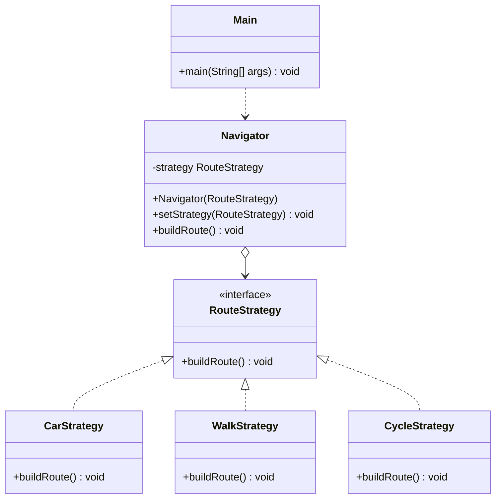

# Assignment 5 - Strategy Pattern

## 1. Introduction

This project uses the Strategy design pattern in Java.
It is a simple navigation system with three route strategies:
car, walking, and bicycle.

Each strategy uses the same interface, but has its own way to build a route.
The Navigator can change the strategy at runtime.

## 2. UML Class Diagram

## 3. Clean Code Principles

### 1. Meaningful Names

Class names such as `CarStrategy` and `WalkStrategy` show what each class does.

### 2. Single Responsibility

Each strategy has one responsibility: building a route for one transport type.

### 3. Polymorphism

All strategies implement `RouteStrategy`. The Navigator calls `buildRoute()` without checking the concrete strategy type.

### 4. Encapsulation

The strategy field in `Navigator` is private. It can be changed using `setStrategy()`.

### 5. Easy Extensibility

A new strategy can implement `RouteStrategy` without changing the existing strategy classes or the Navigator class.

For example, we can add `BusStrategy` as a new class.

## 4. Strategy vs. State

Strategy is used when we want to choose between different algorithms.
In this project, the user can choose car, walking, or bicycle routing.

State is used when an object's behavior changes because of its internal state.
Our project chooses an algorithm, so Strategy is the correct pattern.

## 5. Conclusion

The Strategy pattern makes the navigation program flexible.
We can change the route strategy at runtime and add new strategies easily.
The disadvantage is that the project needs more classes.

## 6. GitHub Repository

https://github.com/bekaryszhasuzak2007/Assignment5SDP
